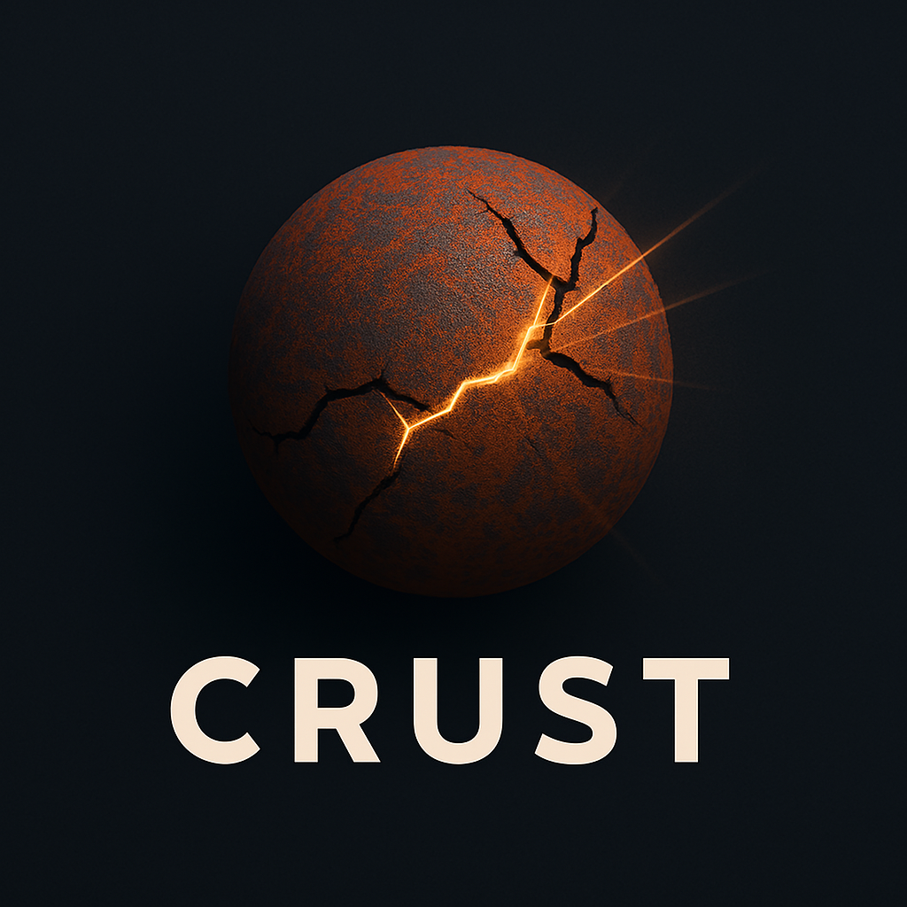
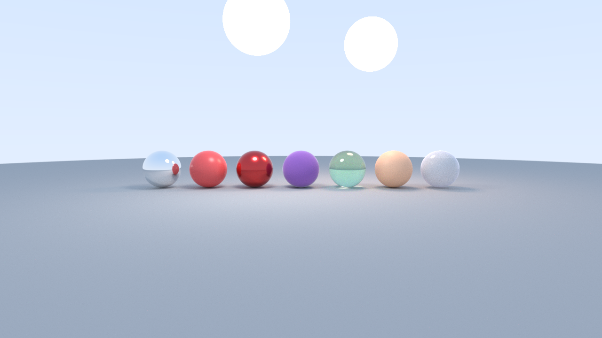
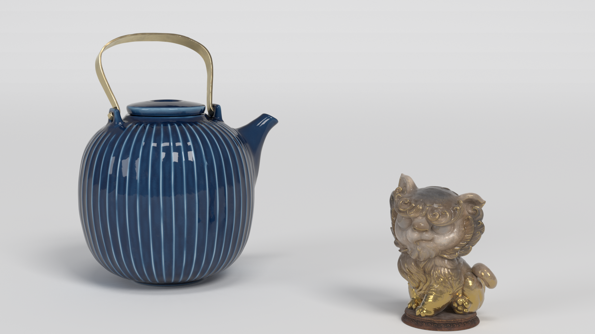
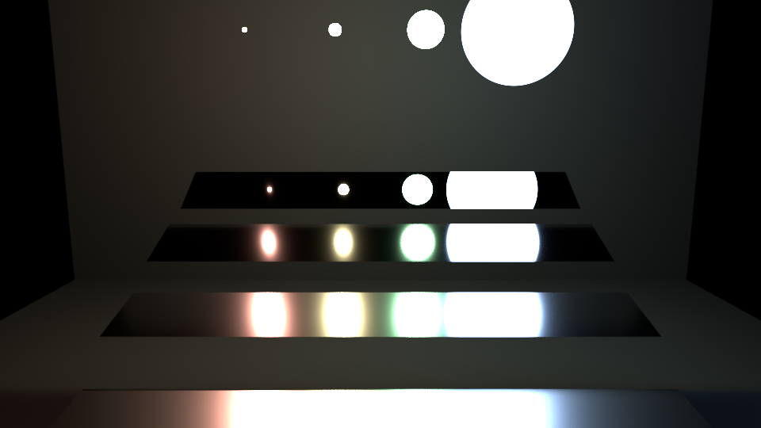
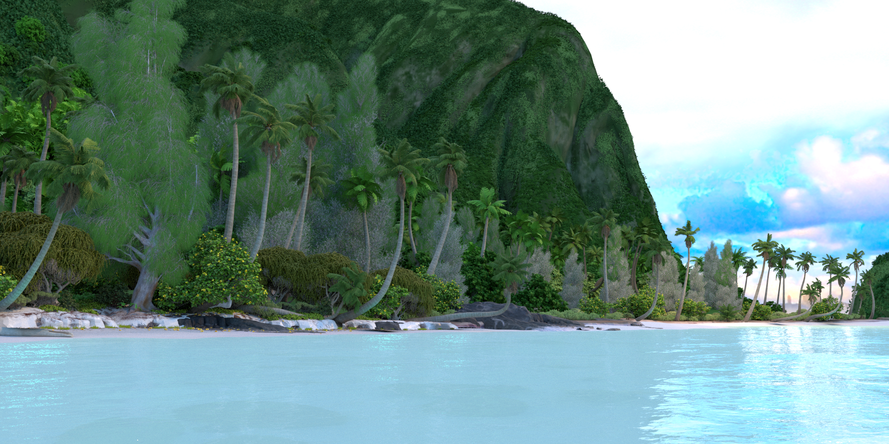

<p align="center">
  <b>USD is the new RIB</b>
</p>

<p align="center">
  
</p>

<p align="center">
  <b>A physically-based path tracer for USD, written in safe Rust.</b>
</p>

<p align="center">
  <a href="https://doubleailes.github.io/crust-render/">Documentation</a> ·
  <a href="https://doubleailes.github.io/crust-render/docs/getting-started/quick-start/">Quick start</a> ·
  <a href="docs/architecture.md">Architecture</a> ·
  <a href="https://doubleailes.github.io/crust-render/docs/architecture/limitations/">Limitations</a>
</p>

<p align="center">
  
</p>

Crust opens a USD stage (`.usda`, `.usdc` or `.usdz`) and renders it. The ray kernel,
BVH, materials, MaterialX reader, volumes and path guiding are all written from scratch,
with no Embree, OpenPGL or existing renderer core underneath. It is a single-author
project built on the ideas in PBRT, *Ray Tracing in One Weekend* and OpenPBR, and it can
render production-scale scenes such as Disney's Moana Island.

## Quick start

```bash
cargo run --release -- render -i samples/cornellbox.usda -o cornell.exr   # EXR + tone-mapped PNG
cargo run --release -- render -i samples/openpbr_showcase.usda -s 64      # override spp
cargo run --release -- ls camera -i samples/cornellbox.usda               # list cameras / lights / materials
cargo run --release -- render --help                                      # every flag
```

All the scene data (camera, geometry, lights, materials, render settings) comes from the
USD stage. Renderer-specific settings use `crust:*` attributes on the `RenderSettings`
prim. The [docs site](https://doubleailes.github.io/crust-render/) covers every flag,
attribute and `CRUST_*` environment variable.

## Highlights

| | |
|---|---|
| 🎨 **Materials** | One OpenPBR übershader. `UsdPreviewSurface` is mapped into it, and `crust:openpbr` exposes every OpenPBR input. |
| 🧩 **MaterialX** | Reads `.mtlx` graphs directly, either referenced or inline in USD. Supports BSDF closure trees with MaterialX's layering, `open_pbr_surface` / `standard_surface` / `gltf_pbr`, Chiang hair, UV and UDIM textures, and volume materials. |
| 📐 **Geometry** | Watertight ray/triangle test, an SBVH built into 4-wide SIMD BVH nodes (8-wide for trees too large for the cache), and instancing nested to any depth (including `PointInstancer`). Also handles subdivision, displacement, curves, implicit shapes and transform motion blur. |
| 💡 **Lights** | UsdLux sphere, rect, disk, cylinder, distant and dome lights, with IES profiles, light linking and learned light selection for scenes with many lights. |
| 🎯 **Sampling** | Next-event estimation combined with BSDF sampling through multiple importance sampling, Owen-scrambled Sobol sequences, adaptive sampling and importance-sampled pixel filters. |
| 🧭 **Path guiding** | An opt-in Rust implementation of Practical Path Guiding (SD-tree), refraction included. |
| 🌫️ **Volumes** | Homogeneous, procedural and voxel-grid media, plus media inside closed meshes, with next-event estimation and multiple importance sampling at scatter points. |
| 🖼️ **Textures** | Ray-cone mip filtering, streaming `.tx` tile caches and Ptex (preloaded or streamed). |
| 🗂️ **Output** | Multi-layer EXR with AOVs, light path expressions and light groups, all set from `RenderProduct` / `RenderVar`. |
| 🔍 **Tooling** | `crust check`, `crust diagnostic` (which settings would make this render faster or cleaner), `crust light-paths` and an MCP server for Claude Desktop. |

## Gallery

<table>
  <tr>
    <td width="50%"></td>
    <td width="50%"></td>
  </tr>
  <tr>
    <td align="center"><sub>NVIDIA's DPEL Teapot and Lion, rendered from their shipped MaterialX graphs</sub></td>
    <td align="center"><sub>Veach's MIS scene: light sampling only, BSDF sampling only, MIS combined</sub></td>
  </tr>
</table>

### Moana Island



Disney Animation's [Moana Island](https://www.disneyanimation.com/resources/moana-island-scene/)
is imported straight from `island.usda`, with no preprocessing or conversion. It has
3.15 M geometries, about 58 M unique triangles, and billions more once instances are
expanded. A streaming importer composes one subtree at a time, which bounds peak
composition to roughly one element at a time. Ptex streaming cuts texture residency
from 6 GiB to 0.6 GiB. The full
numbers are in [`openspec/specs/usd-scene-import/design.md`](openspec/specs/usd-scene-import/design.md).

### Alab

<video src="images/alab_v005.mp4" controls muted loop width="100%">
  Your viewer cannot play this video: <a href="images/alab_v005.mp4">download alab_v005.mp4</a>.
</video>

Netflix Animation Studios' [ALab](https://animallogic.com/alab/) 2.2 (shot mk020_0281) is a
production interior: a cluttered lab bench lit by practical lights in lamps and
fixtures. It is a stress test of a different kind from Moana. The challenges:

- **Scale of the stage.** 12 605 instances share 380 prototypes, and 5 722 tiled EXR
  textures stream through the `.tx` cache. A material samples about five textures per
  shading point, so texture lookups take about 38% of render time.
- **Import cost.** Composing the stage is most of the frame (about 1:30 of 1:58), so
  the importer, not the path tracer, is what gets optimized first.
- **Noise from practical lights.** Most light samples are wasted: about 96% of shadow
  rays are occluded, because power-based light selection cannot tell that most
  fixtures are hidden from most points.

See [`docs/alab_profile.md`](docs/alab_profile.md) for the measurements.

## Project layout

| crate | role |
|---|---|
| `crust-rt` | Intersection kernel: SBVH → BVH4 / BVH8, watertight `Tri4` packets, instancing |
| `crust-mtlx` | MaterialX reader and compiler |
| `crust-jit` | Optional Cranelift JIT for MaterialX programs |
| `crust-nn` | Small deterministic neural networks for light selection |
| `crust-core` | The engine: USD import, integrator, materials, lights, volumes, guiding |
| `crust-assets` | Image, Ptex and IES decoders and texture caches |
| `crust-render` | The `crust` CLI |

Every crate is `forbid(unsafe_code)` except `crust-core` and `crust-jit`, which use
`deny` and allow a few audited exceptions.

## Status

Crust is a production oriented renderer but not use in production. It runs on the CPU only
and has no GPU path. Motion blur covers transforms only, and it does not import OpenVDB.
These gaps are listed in the
[limitations](https://doubleailes.github.io/crust-render/docs/architecture/limitations/)
page and in the "Known gaps" section of each `openspec/specs/*/design.md`.

## License

[MIT](LICENSE). Third-party notices are in [`THIRD-PARTY.md`](THIRD-PARTY.md).
